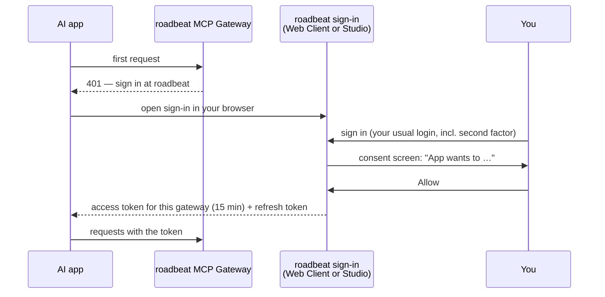

The gateway has no accounts or passwords of its own. You sign in where your roadbeat account already lives, and the AI app receives a short-lived permission to use the gateway on your behalf.

## Which account to use

<Columns cols={2}>
  <Card title="Personal account (Web Client)" icon="user" href="/tools/personal-data">
    Your roadbeat account in the Web Client. Gives the assistant your **goals, follows, bookmarks, Compass** and your **data export**, plus all public content.
  </Card>
  <Card title="Organization account (Studio)" icon="building-2" href="/tools/studio">
    Your user in a roadbeat Studio organization. Gives the assistant your **organization's content**: reading, drafting and — with the right role — publishing.
  </Card>
</Columns>

Each sign-in reaches only its own data: a Studio sign-in shows no personal-data tools, and a personal sign-in shows no Studio tools. Public tools (search, content types, goal catalog) work with both.

## What happens when you connect an app

In plain words:

1. The app asks the gateway, learns that it needs a roadbeat sign-in, and finds out where — all automatically.
2. Your browser opens the roadbeat sign-in. Sign in as usual, including your second factor if you use one.
3. A **consent screen** shows what the app wants to do. You decide.
4. The app receives an **access token** that is valid only for this gateway and only for 15 minutes, plus a **refresh token** that the app uses to get new access tokens. Refresh tokens are replaced on every use and expire 30 days after you connected — then you sign in again.

The app never sees your password, and the gateway never passes the app's token on to other roadbeat services.

## The consent screen

The consent screen shows:

- **"&lt;App&gt; wants to access your roadbeat account"** — the app's name and the website it comes from.
- **Unverified app** — shown when roadbeat could not verify who operates the app. Apps from trusted publishers (by default Claude, identified by `claude.ai` and `anthropic.com`) do not get this banner. Only continue if you trust the app.
- **"This is a desktop or command-line app running on your computer"** — for apps that receive the sign-in result on your own machine, such as Claude Code.
- **It will be able to:** the permissions in plain language, for example *Search public roadbeat content*, *Read your goals, follows and bookmarks*, *Create and edit drafts in your organization*. The technical names are listed on [Scopes](/accounts/scopes).
- **Where you will be returned to** after deciding, and a link to the app's privacy policy if it has one.
- **Allow** and **Deny**.

In Studio, permissions your role does not allow are marked **Not available for your role** and are never granted:

| Studio role | Can grant |
|-------------|-----------|
| Viewer | Public reads, read the organization's content |
| Editor | + create and edit drafts, publish and unpublish |
| Admin | + Studio administration (`studio:admin`) |
| Platform super admin | + gateway administration (`mcp:admin`), shown as *Administer the roadbeat MCP Gateway: audit log, consents of all users, tool catalog* |

Roles are checked again every time the app refreshes its token: if your role is lowered, the app's next token is narrowed too.

<Callout kind="info">
  Signing in is only the first step. The first time an app reads your personal data, changes something or exports data, the gateway additionally asks for your **consent** for that kind of access — and deleting or publishing asks for a **confirmation** every time. See [Consent & Confirmations](/accounts/consent).
</Callout>

## See your connected apps

<Tabs>
  <Tab title="Web Client" icon="user">
    Open **Connected AI apps** in the sidebar. You see every AI app connected to your personal account and when you connected it.

    If your roadbeat provider has set up a gateway, the page starts with a **Connect an AI assistant** card: the connector URL to copy, and setup steps for Claude, Claude Code, ChatGPT, Cursor and — when offered — the Claude Desktop extension download.

    Apps use the browser sign-in you approved them with. **Signing out of that browser session disconnects them** and cuts their access to your data at once.
  </Tab>
  <Tab title="Studio" icon="building-2">
    Open your **Profile › Connected AI apps**. You see every AI app connected to your Studio account, and your [personal access tokens](/accounts/access-tokens) for scripts and tools that cannot sign in through a browser (**Create MCP access token**).

    Organization admins register their organization's own sign-in apps under **Settings › Sign-in apps** — only members of that organization can sign in through them. Platform admins manage all pre-registered apps under **Platform admin › OAuth clients**. See [Pre-register clients](/self-hosting/authorization-servers#pre-register-clients).
  </Tab>
</Tabs>

## Disconnect an app

Select **Disconnect** next to the app. The effect is immediate:

- Every request for your personal or organization data is refused from that moment on — Studio and the Web Client check the app's connection on every request, so even access the gateway obtained a moment earlier stops working.
- The app cannot refresh its token any more.
- The app's current gateway token keeps working for public data until it expires (at most 15 minutes).

To use the app again, connect it again from the app; you will see the sign-in and consent screen once more.

<Callout kind="tip">
  You can also disconnect from inside the app (for example **Settings › Connectors** in Claude), but only disconnecting in roadbeat guarantees that the app's tokens stop working.
</Callout>

To keep the app connected but withdraw what you allowed it in the gateway, ask it to run [`gateway_revoke_my_consents`](/tools/gateway#gateway_revoke_my_consents) — it will ask for your consent again next time.
