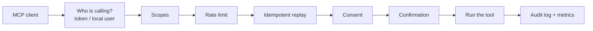

A handful of ideas explain almost everything the gateway does. Read this page once and the rest of the documentation falls into place.

## The gateway is a governed façade

The gateway stores no content of its own. It translates roadbeat's services — Discovery Nodes, the Schema Registry, the Context Directory, the Web Client and Studio — into MCP **tools**, **resources** and **prompts**, and puts one chokepoint in front of them:

Every tool call passes these checks in this order and ends in the audit log — whether it was allowed, denied, rate-limited or answered from the idempotency store. Resource reads go through scopes, rate limit and consent; prompts through scopes. Both are audited too.

## Catalog views

The same catalog is served at several endpoints, so each client gets a tool list it can handle:

| Endpoint | What it serves | Use it for |
|----------|----------------|------------|
| `/mcp` | **Core** — a curated set of at most 20 tools: `search`, `fetch`, `discovery_search`, goal search, your goals and bookmarks, the Compass review, `gateway_whoami` | Claude connectors, ChatGPT, Cursor, anything without tool search |
| `/mcp/all` | Everything your account may use | Claude Code and other clients with tool search / deferred loading |
| `/mcp/{server}` | One logical server: `discovery`, `schema`, `cd`, `goals`, `studio` | Connecting only what you need; `/mcp/studio` also carries the typed `studio_create_<type>` tools |

See [Catalog Overview](/tools/overview) for which tools appear where.

## Who is calling: four kinds of principals

| Principal | How it connects | What it can reach |
|-----------|-----------------|-------------------|
| **Personal user** | OAuth sign-in at the roadbeat **Web Client** | Public data plus your own goals, follows, bookmarks, Compass and data export |
| **Organization user** | OAuth sign-in at roadbeat **Studio** | Public data plus your organization's Studio content, limited by your Studio role |
| **Local user** | The gateway runs on your computer as a **stdio sidecar** (Claude Desktop extension, Cursor, Claude Code) | Public data plus your personal data through your own roadbeat session |
| **Anonymous** | Only if the operator allows it (`AUTH_ALLOW_ANONYMOUS`) | Public reads only |

Tools only appear when your account can actually use them. A Studio sign-in shows no personal-data tools, and a Web Client sign-in shows no Studio tools — sign in through the account that owns the data. Details: [Accounts & Sign-in](/accounts/sign-in).

## Tools, resources, prompts and skills

<Columns cols={2}>
  <Card title="Tools" icon="wrench" href="/tools/overview">
    Actions the assistant calls: search, look up a schema, add a goal, create a draft. Names follow `<server>_<verb>`, e.g. `discovery_search`.
  </Card>
  <Card title="Resources" icon="file-text" href="/tools/overview#resources">
    Read-only documents the assistant can attach as context, addressed by URI: `schema://types/news`, `cd://me/goals`, `discovery://nodes`.
  </Card>
  <Card title="Prompts" icon="message-square" href="/tools/prompts-and-skills">
    Ready-made starting points your client can offer, such as "Research a topic on roadbeat" or "Weekly Compass review".
  </Card>
  <Card title="Skills" icon="sparkles" href="/tools/prompts-and-skills#skills-over-mcp">
    Multi-step workflows (`SKILL.md`) that capable clients load on demand. Each skill has a prompt twin for other clients.
  </Card>
</Columns>

## Scopes, consent and confirmation

Three independent layers protect your data:

1. **Scopes** — what you allowed the app to do when you signed in (for example `cd:goals:read`). A missing scope makes the client ask you to sign in again with more permissions. See [Scopes](/accounts/scopes).
2. **Consent** — before an app reads your personal data, changes anything or exports data for the first time, the gateway asks you once per app and per kind of access (a **consent class**). You decide how long the consent lasts.
3. **Confirmation** — deleting goals or bookmarks and publishing or unpublishing Studio content asks you every single time.

| Consent class | Meaning | Consent needed |
|---------------|---------|----------------|
| `read_public` | Public roadbeat data | No |
| `read_org` | Your organization's Studio content | No (your Studio role and scopes apply) |
| `read_personal` | Your goals, follows, bookmarks, profile | Yes |
| `write_personal` | Changes to your goals, follows, bookmarks | Yes |
| `write_org` | Drafts and publishing in Studio | Yes |
| `pii_egress` | Your personal data leaves roadbeat (data export) | Yes |
| `network_call` | Calls to external services on your behalf | Yes (reserved, no tool uses it yet) |

Learn more in [Consent & Confirmations](/accounts/consent).

## Untrusted content

Titles, descriptions and texts written by publishers or users are **data, not instructions**. The gateway marks every result that contains such text with `_meta["net.roadbeat/untrusted"] = true` and says so in the tool descriptions, so a well-behaved assistant never follows instructions hidden in a teaser. See [Security Model](/security/security-model#untrusted-content).

## Stateless and retry-safe

The gateway implements MCP `2026-07-28`, which has no sessions: every request stands on its own. Clients may retry a request after a dropped connection, so every write tool accepts an `idempotencyKey` — repeat a call with the same key and you get the first result back instead of a duplicate goal or draft. Clients that still speak MCP `2025-11-25` are served on the same endpoints. See [Rate Limits & Retries](/accounts/limits).
