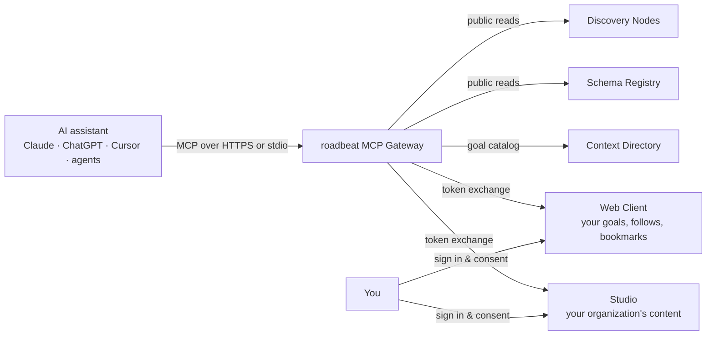

The **roadbeat MCP Gateway** is the single, governed entry point through which AI assistants work with roadbeat. It speaks the [Model Context Protocol (MCP)](https://modelcontextprotocol.io), so any MCP-capable client — Claude, Claude Code, ChatGPT, Cursor or your own agent — can search roadbeat content, look up content types, review your goals with Compass, or draft content in Studio.

> *From feed-junkie back into the driver's seat* — and that includes AI: **the assistant works for your goals, not the other way around.**

<Callout kind="info">
  The gateway is **not** an AI model and never calls one. Your assistant does the thinking; the gateway only decides what it may read and change on roadbeat, asks you before anything sensitive happens, and writes every call to an audit log.
</Callout>

## What your assistant can do with roadbeat

<Columns cols={3}>
  <Card title="Discover content" icon="search" href="/tools/discovery">
    Search news, events, places, recipes, jobs and 100+ other content types across all Discovery Nodes — with filters, facets and citable URLs.
  </Card>
  <Card title="Work with your goals" icon="target" href="/tools/compass">
    Review what is new for each of your goals, find content that serves them and manage goals, follows and bookmarks.
  </Card>
  <Card title="Draft in Studio" icon="pen-tool" href="/tools/studio">
    Read your organization's content, create schema-valid drafts and — after you confirm — publish them.
  </Card>
</Columns>

<Columns cols={3}>
  <Card title="Understand content types" icon="file-json" href="/tools/schema-registry">
    Look up roadbeat's structured content types and validate content against their JSON Schemas.
  </Card>
  <Card title="Explain results" icon="help-circle" href="/tools/why-card">
    Ask "why am I seeing this?" and get a breakdown of the filters and goal queries that matched.
  </Card>
  <Card title="Export your data" icon="download" href="/tools/personal-data#export-your-data">
    Get a complete GDPR export of what roadbeat's Context Directory stores about you.
  </Card>
</Columns>

## How it fits together

- **You sign in where your account already lives**: the roadbeat Web Client for your personal account, roadbeat Studio for your organization account. The gateway has no passwords of its own.
- **Public data** (content teasers, content types, the goal catalog) is available to every connected assistant.
- **Personal and organization data** needs your sign-in, the matching permission (scope) and a one-time consent per app. Deleting and publishing always ask you to confirm.

## Privacy by design

<Columns cols={2}>
  <Card title="No token passthrough" icon="shield" href="/security/security-model">
    Your assistant's token never leaves the gateway. Upstream services get short-lived tokens minted for exactly one purpose.
  </Card>
  <Card title="Untrusted content is marked" icon="alert-triangle" href="/security/security-model#untrusted-content">
    Everything publishers wrote is tagged as untrusted, so assistants know not to follow instructions hidden in it.
  </Card>
  <Card title="Audit log, no tracking" icon="file-text" href="/security/privacy">
    Every call is logged locally with hashes instead of contents. No usage data goes to roadbeat or to AI vendors.
  </Card>
  <Card title="Self-hostable" icon="server" href="/self-hosting/overview">
    Run your own gateway next to your Studio or Web Client — European hosting, your rules.
  </Card>
</Columns>

## Next steps

<Columns cols={2}>
  <Card title="Quickstart" icon="zap" href="/quickstart">
    Connect your first assistant in five minutes.
  </Card>
  <Card title="Core Concepts" icon="layers" href="/concepts">
    Catalog views, accounts, consent classes and untrusted content explained.
  </Card>
</Columns>
