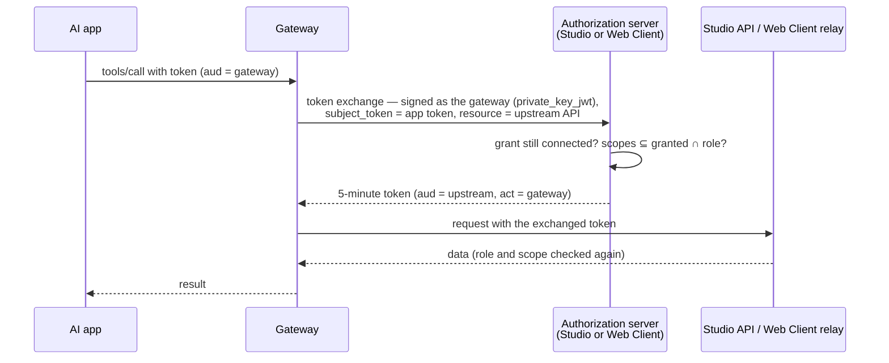

The gateway assumes that AI apps can be wrong, that content can be hostile and that tokens can leak. Each layer below limits the damage of one of these.

## Tokens: resource server only

The gateway is an **OAuth 2.1 resource server**. It never issues tokens and never sees passwords. The authorization servers are the roadbeat **Studio API** (organization accounts) and the roadbeat **Web Client API** (personal accounts), or an OpenID provider an operator configures.

Every access token must:

- come from an **allow-listed issuer** and be signed with an **asymmetric** algorithm (RS256/384, PS256/384, ES256/384, EdDSA) — shared-secret and unsigned tokens are refused;
- be an **RFC 9068 access token** (`typ: at+jwt`) — refresh tokens, ID tokens or second-factor challenge tokens replayed as access tokens are refused;
- carry the endpoint as **audience** (RFC 8707), e.g. `https://mcp.roadbeat.net/mcp` — a token for another service, or for another roadbeat gateway, does not work here;
- not be expired (30 seconds clock tolerance by default) and carry the **scopes** the call needs.

Tokens are only accepted in the `Authorization` header, never in URLs, and never written to logs. Access tokens live 15 minutes; refresh tokens rotate on every use and a reused refresh token revokes the whole grant.

## No token passthrough

The app's token is **never forwarded** to another roadbeat service. When a tool needs your personal or organization data, the gateway performs an **RFC 8693 token exchange** at the authorization server that issued your token:

- The exchanged token is valid for **five minutes**, only for the one upstream API, and only for the intersection of what was requested, what you granted, what that API understands and what your role allows. It names the gateway as the acting party (`act`), so the delegation is visible in every log, and it cannot be exchanged again.
- Each exchanged token names the grant it was issued under. Studio and the Web Client relay check on **every request** that this grant still exists, so disconnecting the app cuts its access at once — even an exchanged token issued a moment earlier is refused.
- **Personal data** goes through the Web Client's Context Directory **relay**: a fixed allow-list of Context Directory paths, each mapped to a scope. Your Context Directory tokens never leave the Web Client.
- **Studio** accepts exchanged tokens only on its content, content-type, publishing, translation, locale and media library endpoints (deny by default; provider settings and consent stay closed) and applies the lower of your role and the role your scopes allow.
- **Public data** (Discovery Nodes, Schema Registry, the goal catalog) is read without any user credential.

The local sidecar has no app token: it uses the Context Directory session you created with `login`, on your own machine.

## Untrusted content

Everything publishers or users wrote — teaser titles and texts, highlights, goal notes, Studio content — is **data, not instructions**:

- Results that contain such text carry `_meta["net.roadbeat/untrusted"]: true`.
- Tool descriptions and the server instructions tell the assistant which outputs are untrusted and never to follow instructions inside them; every prompt and skill repeats that rule.
- Outputs are sanitized (no signatures, indexing metadata, vectors or publisher contact data) and size-capped.

This does not make prompt injection impossible — it gives the assistant clear signals, and consent and confirmation stop an injected instruction from deleting or publishing anything without you.

## Server-side consent and confirmation

Some clients run tools without asking you, so the gateway never relies on the client's approval UI:

- Personal reads, all writes and exports need your [consent](/accounts/consent) per app; deleting and publishing need a confirmation per call.
- Confirmations are bound to the exact arguments. The state the gateway hands to the app between the question and the answer is signed (HMAC) and bound to your account, the app and the method — forged, swapped or stolen state is rejected.
- Approval pages use signed links, a CSRF-protected form, `no-store` caching and cannot be framed.

<Callout kind="alert">
  In release 0.1.0 the approval page trusts its signed link and does not yet require you to sign in again. Treat approval links like one-time passwords and do not share them; links expire after 10 minutes.
</Callout>

## A static, reviewed catalog

The gateway only serves tools that ship with its own code — it never loads tools from other MCP servers at runtime, so a third-party server cannot impersonate a roadbeat tool or "rug-pull" its description. Tool lists are deterministic and every tool carries truthful annotations. Operators can switch individual tools off.

## Network protections

- **Origin validation**: browser requests from origins outside `MCP_ALLOWED_ORIGINS` are refused (protection against DNS rebinding).
- **Header/body consistency**: the MCP routing headers (`Mcp-Method`, `Mcp-Name`) must match the request body.
- **Rate limits** per account and app, plus per-tool limits — see [Rate Limits & Retries](/accounts/limits).
- The local sidecar talks over stdio only and opens no network port.

## Audit

Every tool call, resource read, prompt, consent decision, confirmation and admin action ends in the append-only audit log with the principal, the app, the trace id and the result — including denials and rate-limit hits. Arguments are stored as SHA-256 hashes; tokens and raw personal content are never logged. Records are deleted after the retention period (365 days by default), and erasing a person re-keys their records to a random pseudonym. See [Operations](/self-hosting/operations#audit-log).

## Admin access

The [admin UI](/self-hosting/admin-ui) and the Admin API need the `mcp:admin` scope, which Studio grants only to platform super admins. The UI signs in with authorization code + PKCE, checks the issuer of the response, keeps its tokens in the browser tab's session storage and revokes the refresh token on sign-out. Its page runs under a strict Content Security Policy and cannot be framed.

## Reporting a vulnerability

Please report security issues privately to roadbeat e.V. via [roadbeat.net](https://roadbeat.net) rather than in public issue trackers.
