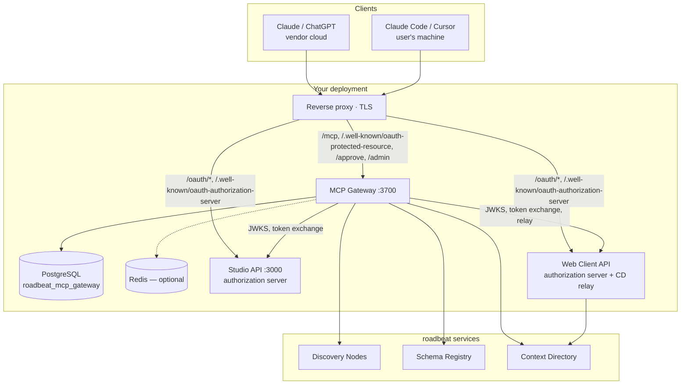

Every roadbeat deployment can run its own gateway — there is no central AI broker. The gateway is a single NestJS service with a PostgreSQL database; it needs no AI model and no outside services.

## Deployment modes

| Mode | Who signs in | Transport | Typical URL |
|------|--------------|-----------|-------------|
| **Studio-integrated** | Studio users of your organizations | Streamable HTTP | `https://studio.example.com/mcp` or `https://mcp.example.com/mcp` |
| **Web Client-integrated** | Personal roadbeat users | Streamable HTTP | `https://app.example.com/mcp` or `https://mcp.example.com/mcp` |
| **Both** | Studio and personal users (two trusted issuers) | Streamable HTTP | one gateway, both authorization servers listed |
| **Local sidecar** | One person, on their own computer | stdio | started by Claude Desktop, Claude Code or Cursor |

Hosted assistants (Claude on the web, Claude Desktop connectors, ChatGPT) connect from their vendors' clouds, so an HTTP gateway for them must be **publicly reachable over HTTPS**.

## Architecture

## Requirements

| Component | Version / notes |
|-----------|-----------------|
| Runtime | Node.js ≥ 20.19 (the Docker image uses Node 22 LTS) |
| Database | PostgreSQL (roadbeat uses 18) — database `roadbeat_mcp_gateway` |
| Redis | Optional. Shares rate-limit windows between several gateway instances; without it each instance counts on its own |
| Authorization server | roadbeat Studio and/or Web Client with the OAuth authorization server enabled (`OAUTH_ISSUER`), or an OpenID provider that issues RFC 9068 access tokens |
| Upstreams | One or more Discovery Nodes, the Schema Registry, the Context Directory |
| TLS | Public HTTPS for hosted assistants; `localhost` is fine for local clients |

## Deployment checklist

<Steps>
  <Step title="Enable the authorization server(s)">
    Set the `OAUTH_*` variables in Studio and/or the Web Client API, run their migrations and route `/oauth/*` and `/.well-known/oauth-authorization-server*` to their APIs. See [Authorization Servers](/self-hosting/authorization-servers).
  </Step>
  <Step title="Create the gateway's keys and secrets">
    An ES256 key pair for the gateway's token-exchange client (`GATEWAY_OAUTH_KEY`, public half registered at each authorization server) and a random `REQUEST_STATE_SECRET` of at least 32 bytes.
  </Step>
  <Step title="Run the gateway">
    Docker image, database migration, environment. See [Run with Docker](/self-hosting/docker) and the [Configuration Reference](/self-hosting/configuration).
  </Step>
  <Step title="Route it">
    Publish `/mcp`, `/mcp/*`, `/.well-known/oauth-protected-resource*` and `/approve/*` through your reverse proxy — plus `/admin*` and `/api/v1/admin*` for the [admin UI](/self-hosting/admin-ui), ideally only from your admin network. Set `PUBLIC_BASE_URL` to exactly the public origin.
  </Step>
  <Step title="Smoke test">
    `GET /api/v1/health`, the protected resource metadata, then connect Claude Code with `claude mcp add --transport http roadbeat https://<gateway>/mcp` and sign in. See [Operations](/self-hosting/operations).
  </Step>
</Steps>
