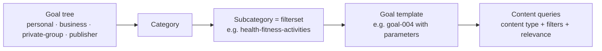

roadbeat's Compass is built on a public **goal catalog**: goal templates ("Run a half marathon", "Start a company in `{{field}}`") organized in trees, categories and subcategories (filtersets). Each template knows which content serves it through its **content queries**. These tools and resources are public (`read_public`, scope `cd:read:public`) and need no sign-in to personal data.

Endpoint: `/mcp/cd` (and `/mcp/all`; `cd_search_goal_templates` is also in the core set).

## How the pieces fit

A goal is identified by **`filtersetId` + `goalId`**. Pass that pair to [`discovery_search_by_goal`](/tools/discovery#discovery_search_by_goal) to find matching content, or to [`cd_add_goal`](/tools/personal-data#cd_add_goal) to adopt the goal.

## Tools

### `cd_search_goal_templates`

Searches goal templates by topic.

<ParamField body="q" param-type="string" required="true">What the goal is about, e.g. `fitness`, `learn a language` (2–200 characters).</ParamField>
<ParamField body="treeId" param-type="string">Limit to one tree: `personal`, `business`, `private-group`, `publisher`.</ParamField>
<ParamField body="limit" param-type="integer">1–25, default 10.</ParamField>

Each hit returns `filtersetId`, `goalId`, `text`, `category`, `subcategory`, `tree` and the names of its `parameters`.

### `cd_get_goal_template`

Shows one template in detail: text (translated if you pass `locale`), parameters with suggested values, time horizons (`day`, `week`, `month`, `year`, `life`), the content queries it runs (content type, relevance, filters) and how progress is tracked.

<ParamField body="filtersetId" param-type="string" required="true">Subcategory id.</ParamField>
<ParamField body="goalId" param-type="string" required="true">Goal id.</ParamField>
<ParamField body="locale" param-type="string">Two-letter language code for the goal text.</ParamField>

## Resources

| URI | Content | Cache |
|-----|---------|-------|
| `cd://goals/trees` | The four goal trees | 5 min |
| `cd://goals/trees/{treeId}` | Categories and subcategories (filtersets) of a tree, with goal counts | 5 min |
| `cd://goals/templates/{filtersetId}` | All goal templates of a subcategory, with parameters and content queries | 5 min |
| `cd://geo/countries` | Countries (ISO 3166-1) | 1 h |
| `cd://geo/regions/{countryCode}` | Regions (ISO 3166-2) of a country, with coordinates | 1 h |
